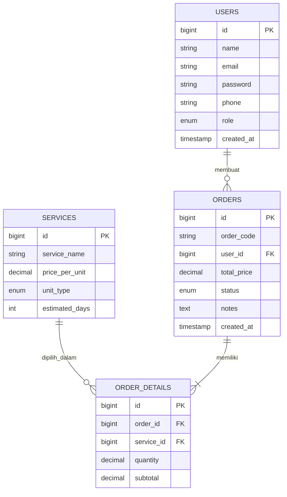

# Dokumentasi Skema Basis Data (Database Schema)

Dokumen ini menjelaskan struktur tabel, tipe data, kunci utama/asing, serta relasi antar entitas untuk Aplikasi Manajemen / Website Laundry Online.

---

## 1. Diagram Relasi Entitas (ERD)

---

## 2. Rincian Tabel Basis Data

### A. Tabel `users`
Menyimpan data pengguna akun sistem (Pelanggan dan Admin).

| Nama Kolom  | Tipe Data      | Keterangan / Batasan                      |
| :---------- | :------------- | :---------------------------------------- |
| `id`        | BIGINT         | Primary Key, Auto Increment               |
| `name`      | VARCHAR(100)   | Nama lengkap pengguna (Not Null)          |
| `email`     | VARCHAR(100)   | Alamat email unik (Unique, Not Null)      |
| `password`  | VARCHAR(255)   | Kata sandi terenkripsi / Hashed (Not Null)|
| `phone`     | VARCHAR(20)    | Nomor telepon / WhatsApp (Nullable)       |
| `role`      | ENUM           | Value: `'admin'`, `'pelanggan'`           |
| `created_at`| TIMESTAMP      | Waktu pendaftaran akun                    |
| `updated_at`| TIMESTAMP      | Waktu pembaruan data                      |

### B. Tabel `services`
Menyimpan master data paket dan layanan laundry yang ditawarkan.

| Nama Kolom      | Tipe Data      | Keterangan / Batasan                   |
| :-------------- | :------------- | :------------------------------------- |
| `id`            | BIGINT         | Primary Key, Auto Increment            |
| `service_name`  | VARCHAR(100)   | Nama layanan (misal: Cuci Komplit)     |
| `price_per_unit`| DECIMAL(10,2)  | Harga per satuan/kg                    |
| `unit_type`     | ENUM           | Value: `'kg'`, `'pcs'`                 |
| `estimated_days`| INT            | Estimasi lama pengerjaan (dalam hari)  |
| `created_at`    | TIMESTAMP      | Waktu pembuatan data                   |
| `updated_at`    | TIMESTAMP      | Waktu pembaruan data                   |

### C. Tabel `orders`
Menyimpan data utama transaksi pesanan laundry.

| Nama Kolom   | Tipe Data      | Keterangan / Batasan                                  |
| :----------- | :------------- | :---------------------------------------------------- |
| `id`         | BIGINT         | Primary Key, Auto Increment                           |
| `order_code` | VARCHAR(20)    | Kode unik transaksi (Unique, Not Null)                |
| `user_id`    | BIGINT         | Foreign Key -> `users.id`                             |
| `total_price`| DECIMAL(12,2)  | Total biaya keseluruhan                               |
| `status`     | ENUM           | Value: `'pending'`, `'proses'`, `'selesai'`, `'diambil'` |
| `notes`      | TEXT           | Catatan khusus dari pelanggan (Nullable)              |
| `created_at` | TIMESTAMP      | Waktu pesanan dibuat                                  |
| `updated_at` | TIMESTAMP      | Waktu pembaruan status                                |

### D. Tabel `order_details`
Menyimpan rincian item/layanan yang dipesan dalam satu transaksi.

| Nama Kolom  | Tipe Data     | Keterangan / Batasan                      |
| :---------- | :------------ | :---------------------------------------- |
| `id`        | BIGINT        | Primary Key, Auto Increment               |
| `order_id`  | BIGINT        | Foreign Key -> `orders.id` (ON DELETE CASCADE)|
| `service_id`| BIGINT        | Foreign Key -> `services.id`              |
| `quantity`  | DECIMAL(8,2)  | Jumlah berat (kg) atau jumlah unit (pcs)  |
| `subtotal`  | DECIMAL(12,2) | Hasil perkalian `quantity` x `price_per_unit` |

---

## 3. Aturan Integritas Data (Data Integrity)
1. **Aturan Hapus (On Delete):** Jika data pesanan di tabel `orders` dihapus, seluruh rincian transaksi terkait di `order_details` otomatis terhapus (*Cascade*).
2. **Keamanan Akses:** Hak akses baca/tulis ke tabel `orders` untuk peran `pelanggan` dibatasi secara ketat hanya untuk baris data yang memiliki `user_id` cocok dengan id pengguna yang sedang login.